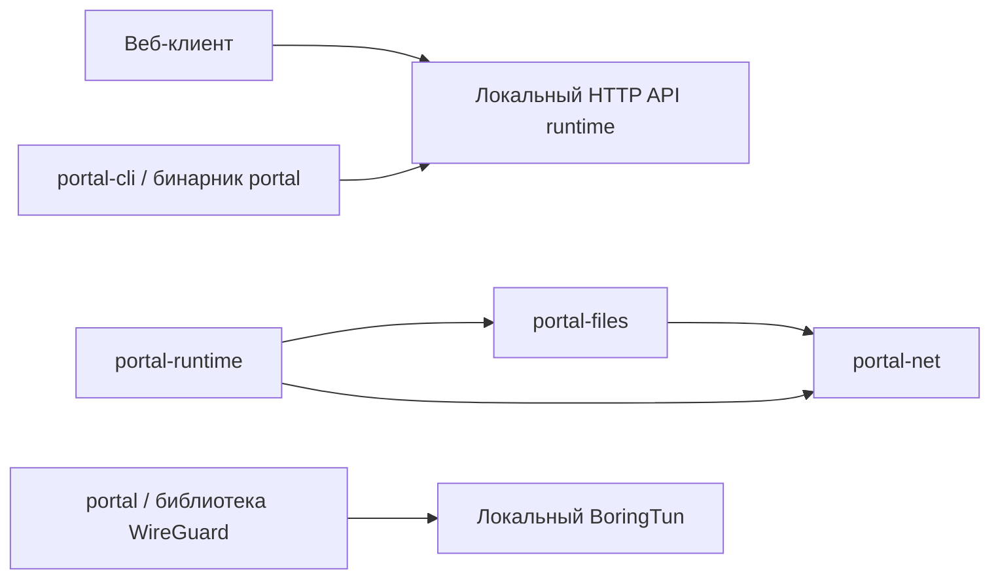

# Карта кодовой базы Portal

Проверено по рабочей копии репозитория 14 октября 2026 года. Карта описывает
реализованный код, включая незакоммиченные изменения после перехода на QUIC.

## 1. Общая структура

Основное приложение передаёт запросы сервисов по QUIC через реальные UDP-адреса.
Локальное управление остаётся HTTP. WireGuard сохранён в workspace как отдельная
библиотека, но сервисный runtime её не использует.

```text
portal/
├── Cargo.toml                         Rust workspace и patch BoringTun
├── Cargo.lock                         Зафиксированные зависимости
├── README.md                          Запуск, протокол и миграция
├── docs/CODE_MAP.md                    Эта карта
├── runtime/                           Процесс приложения и управление сервисами
│   ├── src/main.rs                    Запуск из JSON-конфигурации
│   ├── src/lib.rs                     Публичный API runtime
│   ├── src/config.rs                  Чтение и проверка настроек
│   ├── src/service.rs                 Жизненный цикл приложения, команды, reload
│   ├── src/services.rs                Регистрация сервисов и фабрики
│   ├── src/peer_services.rs           Запуск QUIC-обработчиков и фоновых задач
│   ├── src/api.rs                     Локальный HTTP API
│   ├── src/platform/mod.rs            Выбор платформы и HostPlatform
│   ├── src/platform/linux.rs          SIGINT/SIGTERM
│   ├── src/platform/linux/api_token.rs Файл токена локального API
│   └── scripts/check-quic.py          Проверка двух процессов целиком
├── net/                               QUIC-транспорт и протокол операций
│   ├── src/lib.rs                     Net, endpoint, доверенные пиры, соединения
│   ├── src/tls.rs                     Ed25519, сертификаты, взаимная аутентификация
│   ├── src/rpc.rs                     Потоки, рамки, Registry и диспетчеризация
│   └── tests/network.rs               Сетевые тесты транспорта
├── files/                             Встроенный файловый сервис
│   ├── src/lib.rs                     Публичные экспорты
│   ├── src/service.rs                 FileService, состояние и лимит скачиваний
│   ├── src/api.rs                     Операции и доступ к файловой системе
│   ├── src/models.rs                  JSON-модели файлов и каталогов
│   ├── src/client.rs                  QUIC-запросы и потоковые ответы для runtime
│   └── tests/quic.rs                  Проверки файлов через QUIC
├── cli/                               Управляющий CLI
│   ├── src/main.rs                    Команды и аргументы
│   ├── src/http_api.rs                Синхронный клиент локального HTTP API
│   └── src/keys.rs                    Генерация Ed25519 seed-файла
└── wireguard/                         Самостоятельная библиотека для будущего VPN
    ├── src/lib.rs                     Публичные экспорты Device
    ├── src/device/mod.rs              Владение устройством и управление пирами
    ├── src/device/config.rs           AllowedIp и типы конфигурации
    ├── src/device/registry.rs         Индексы пиров и таблица маршрутов
    ├── src/runtime/mod.rs             Подключение worker-модуля
    ├── src/runtime/worker.rs          Обработка UDP/IP и таймеры WireGuard
    ├── src/platform/mod.rs            Выбор backend через cfg
    ├── src/platform/linux/mod.rs      UDP, epoll, eventfd, PacketPort
    └── vendor/boringtun/              Локальный fork BoringTun 0.7.1
```

### Пакеты и бинарники

| Каталог | Cargo package | Что собирается | Назначение |
|---|---|---|---|
| `runtime` | `portal-runtime` | Библиотека и `portal-runtime` | Владелец приложения, сети и сервисов |
| `net` | `portal-net` | Библиотека | QUIC и нативные операции между пирами |
| `files` | `portal-files` | Библиотека, встроенная в runtime | Встроенный файловый сервис и QUIC-запросы |
| `cli` | `portal-cli` | Бинарник `portal` | Управление runtime и генерация ключей |
| `wireguard` | `portal` | Библиотека | Встраиваемый WireGuard Device |

Имя `portal` неоднозначно: Cargo package `portal` — WireGuard-библиотека,
а исполняемый файл `portal` принадлежит package `portal-cli`.

### Зависимости между нашими пакетами



Стрелки к локальному API обозначают запросы между процессами, остальные —
зависимости Cargo. У runtime нет зависимости от WireGuard-библиотеки.
Quinn/rustls находятся в `net`; Axum — в `runtime`; Hyper обслуживает локальный HTTP API через Axum. В `files` HTTP-клиента нет.
smoltcp в зависимостях отсутствует.

## 2. Точки входа и запуск

[runtime/src/main.rs](../runtime/src/main.rs) — точка входа процесса. Она читает
`PORTAL_CONFIG` или использует `portal.json` из текущего каталога, затем вызывает
`load_config()` и публичный `run()`. Команд и парсера CLI внутри runtime нет.

[runtime/src/lib.rs](../runtime/src/lib.rs) экспортирует `run`, `load_config`,
`RuntimeConfig`, `SecretKey`, `ServiceContext`, `ServiceRegistration` и
`ServiceImplementation`. Рабочий backend runtime сейчас Linux; для остальных ОС
`run()` возвращает сообщение об отсутствии реализации.

В [runtime/src/service.rs](../runtime/src/service.rs) последовательность такая:

1. `run_device()` создаёт один многопоточный Tokio runtime с именем рабочих
   потоков `portal-async`. Название функции историческое: WG Device здесь уже нет.
2. `run_with_executor()` устанавливает обработчики сигналов и создаёт `Net` на
   UDP-адресе `listen`; исходный seed в `options` после этого обнуляется.
3. `start_services()` запускает зарегистрированные сервисы на этом же executor.
4. Создаются общее управляющее состояние `Runtime` и канал перезагрузки.
5. `LocalApi::start()` открывает локальный HTTP listener и создаёт файл токена.
6. После готовности сервисного сервера печатается `READY net=quic ...`.
7. Главный поток проверяет состояние и обрабатывает запросы перезагрузки с
   интервалом 100 мс.
8. Остановка: локальный API → сервисы → QUIC endpoint → общий Tokio runtime.

`Runtime` содержит `Net`, флаг остановки и отправитель запросов перезагрузки.
Таблица пиров хранится в самом `Net`, а не в отдельном списке runtime.

## 3. Конфигурация и состояние на диске

[runtime/src/config.rs](../runtime/src/config.rs):

| Элемент | Ответственность |
|---|---|
| `FileConfig` | Входной JSON: `private_key_file`, `listen`, `api_listen`, `api_token_file`, `services` |
| `RuntimeConfig` | Проверенные настройки и готовые регистрации сервисов для запуска |
| `ServiceConfig` | Декодер встроенных сервисов; сейчас вариант `Files` |
| `load_config()` | Читает JSON и seed, проверяет loopback API, разрешает относительные пути |
| `build_services()` | Переводит настройки сервисов в `ServiceRegistration` |
| `load_services()` | Перечитывает список сервисов при reload без загрузки seed |
| `SecretKey` | Обёртка над seed с обнулением через `Drop` |

Неизвестные JSON-поля отклоняются. Относительные пути вычисляются относительно
файла конфигурации. `listen` — настоящий UDP endpoint QUIC. Списка виртуальных
IP-адресов, MTU пользовательского стека или отдельного peer HTTP listener нет.

На диске находятся JSON-конфигурация, seed-файл устройства и временный файл
bearer-токена. По умолчанию API слушает `127.0.0.1:51821`, токен находится в
системном временном каталоге как `portal-UID.token` на Unix.

Доверенные пиры, их endpoints, соединения и регистрации запущенных сервисов
хранятся в памяти процесса. Изменение пиров через API не записывает их в JSON.

## 4. Локальный HTTP API

[runtime/src/api.rs](../runtime/src/api.rs) — единственный HTTP-сервер приложения.

| Маршрут | Обработчик | Назначение |
|---|---|---|
| POST `/api/v1/command` | `handle_command()` | Управление процессом и доверенными пирами |
| POST `/api/v1/files/resources` | `handle_files()` | Ресурсы удалённого файлового сервиса |
| POST `/api/v1/files/list` | `handle_files()` | Содержимое каталога |
| POST `/api/v1/files/metadata` | `handle_files()` | Метаданные пути |
| POST `/api/v1/files/download` | `handle_files()` | Потоковое скачивание через runtime |

`ManagementRequest` задаёт операции `peer_upsert`, `peer_remove`, `endpoint_set`,
`endpoint_clear`, `status`, `health`, `list`, `stats`, `peer_stats`,
`services_reload`, `shutdown`. Диспетчер обычных команд находится в
`Runtime::handle_api_request()` в `runtime/src/service.rs`.

`authenticate()` проверяет IP источника, Host, Origin, Content-Type и bearer token.
Origin, если присутствует, должен соответствовать локальному API. Проверка токена
не прекращает сравнение на первом несовпадении. Максимальное тело HTTP-запроса —
64 КиБ. DTO команд и файловых запросов отклоняют неизвестные поля.

`ApiState` хранит общее управляющее состояние под `Arc<Mutex<Runtime>>`, токен,
адрес listener и клон `Net`. Перед ожиданием QUIC-ответа блокировка состояния
освобождается. Результат QUIC переводится в HTTP status, JSON или поток с
`Content-Length` и `Content-Disposition`. Локальный токен пиру не пересылается.

В [runtime/src/platform/linux/api_token.rs](../runtime/src/platform/linux/api_token.rs)
реализованы создание/обновление и удаление токена: режим 0600, проверка владельца
и обычного файла, открытие с `O_NOFOLLOW`, случайные 32 байта в hex.

## 5. Сеть, пиры и TLS

### Endpoint и соединения

[net/src/lib.rs](../net/src/lib.rs) содержит `Net`, `Inner`, `Peer` и `PeerKey`.

| Метод / тип | Что делает |
|---|---|
| `Net::new()` | Создаёт сертификат и Quinn endpoint; требует контекста Tokio |
| `public_key()`, `listen_addr()` | Идентичность устройства и фактический UDP-адрес |
| `upsert_peer()` | Регистрирует доверенный ключ и необязательный endpoint; закрывает прежние сессии этого ключа |
| `remove_peer()` | Снимает доверие и закрывает сессии пира |
| `peers()`, `has_peer()` | Читают реестр доверенных устройств |
| `connect()` | Выбирает endpoint, проверяет TLS-ключ сервера, кеширует исходящее соединение |
| `track()` | Учитывает входящие/исходящие соединения для лимитов и отзыва |
| `stats()` | Суммирует UDP-счётчики активных отслеживаемых QUIC-сессий |
| `health()` | Проверяет локальный флаг остановки; не является сетевым ping |
| `shutdown()`, `wait_idle()` | Закрывают endpoint и ожидают завершения Quinn |
| `PeerKey` | Ключ пира; обработчик получает его из проверенного TLS-соединения |

`Net` клонируется через `Arc`. Реестр пиров защищён `RwLock`; у каждого пира есть
endpoint, список соединений и async mutex для последовательного установления
соединения к этому пиру. Общего TCP/IP polling-потока здесь нет.

Исходящее соединение переиспользуется по ключу пира. Входящее соединение
обслуживается серверной стороной; если оба устройства инициируют запросы, могут
существовать два соединения между ними. Endpoint нужен инициатору; принимающей
стороне достаточно зарегистрировать доверенный ключ клиента.

### Криптографическая идентичность

[net/src/tls.rs](../net/src/tls.rs) отвечает за TLS:

- `identity()` переводит Ed25519 seed в PKCS#8 и создаёт самоподписанный сертификат.
- `certificate_key()` извлекает Ed25519-ключ из SPKI сертификата.
- `Verifier::check()` проверяет регистрацию ключа; для сервера также проверяет
  точное совпадение с ключом запрошенного пира.
- `verify_tls13_signature()` проверяет доказательство владения ключом через rustls.
- `server()` требует сертификат клиента; `client()` предъявляет сертификат устройства.

ALPN — `portal-rpc/1`; TLS 1.3, подписи Ed25519, 0-RTT отключён. Доверие назначается
ключу устройства, а не публичному CA или DNS-имени. TLS verifier держит слабую
ссылку на реестр пиров, чтобы не образовать цикл владения через соединения.

Сетевое доверие и права сервиса — два разных уровня: регистрация ключа в `Net`
разрешает аутентифицироваться, но не даёт автоматически доступ к файлам.

## 6. Нативный протокол QUIC

[net/src/rpc.rs](../net/src/rpc.rs) содержит протокол и диспетчер операций.

| Тип / функция | Назначение |
|---|---|
| `Request` | `service`, `operation`, JSON `payload` |
| `ResponseHeader` | Код `status`, количество байт `length`, необязательное `file_name` |
| `Response` | Заголовок и тело как async reader; JSON, ошибка или бинарный поток |
| `Service::new()` | Именованный обработчик `(PeerKey, Request)` |
| `Registry::register()` | Проверяет имя и добавляет обработчик сервиса |
| `write_frame()`, `read_frame()` | JSON-рамки с 4-байтной длиной big-endian |
| `Net::request()` | Открывает отдельный двунаправленный поток, отправляет запрос и читает заголовок ответа |
| `Net::serve()`, `serve_with_ready()` | Принимают аутентифицированные соединения и потоки |
| `serve_request()` | Выбирает сервис и отправляет ответ |
| `IncomingResponse`, `IncomingBody` | Чтение ответа и проверка объявленного размера/конца потока |

```text
Запрос: [u32 длина JSON][Request JSON][FIN]
Ответ:  [u32 длина JSON][ResponseHeader JSON][length байт тела][FIN]
```

Один поток содержит один запрос и один ответ. Запрос после JSON должен завершиться:
произвольное потоковое тело загрузки эта версия протокола не принимает. Это
нативный прикладной протокол поверх QUIC, не HTTP/3 и не gRPC.

Сервер получает идентичность из завершённого TLS-рукопожатия и передаёт её
обработчику. Перед вызовом сервиса проверяет, что ключ всё ещё зарегистрирован.
Потоки/соединения обслуживаются задачами `JoinSet`. При остановке сервера
соединения закрываются, активные задачи отменяются.

### Лимиты и таймеры

| Ограничение | Где задаётся | Значение |
|---|---|---|
| Размер JSON запроса | `net/src/rpc.rs` | 16 КиБ |
| Размер заголовка ответа | `net/src/rpc.rs` | 4 КиБ |
| JSON-ответ | `net/src/rpc.rs` | 1 МиБ |
| Имена сервисов | `Registry::register()` | Непустые, уникальные, до 64 байт |
| Зарегистрированные пиры | `Net::upsert_peer()` | 1024 |
| Отслеживаемые сессии одного пира | `Net::track()` | 4 |
| Принимаемые соединения | `Net::serve_with_ready()` | 128 |
| Активные операции сервера | `Net::serve_with_ready()` | 256 |
| Входящие bidi streams на соединение | `TRANSPORT` | 32 |
| Входящие uni streams | `TRANSPORT` | 0 |
| Receive window потока / соединения | `TRANSPORT` | 1 МиБ / 8 МиБ |
| Send window соединения | `TRANSPORT` | 8 МиБ |
| Idle timeout / keepalive | `TRANSPORT` | 60 с / 15 с |
| Подключение с ожиданием очереди; отдельно открытие потока | `net` | 10 с |
| Ожидание заголовка ответа | `net/src/rpc.rs` | 60 с (30 с обработчик + 30 с запас на передачу) |
| Чтение запроса, запись рамки, обработчик, отдельное чтение/запись тела | `net/src/rpc.rs` | 30 с |

Таймеры отдельных этапов не являются единым общим сроком всей операции.
Счётчики `stats` относятся к активным сессиям, а не ко всей истории процесса.

## 7. Файловый сервис

### Создание и состояние

[files/src/service.rs](../files/src/service.rs):

- `FileServiceConfig`: корневая папка и `HashSet<PeerKey>` разрешённых читателей.
- `FileService::new()`: canonicalize корня, проверка каталога и непустых разрешений.
- `SharedState`: корень, разрешённые ключи и semaphore на 128 скачиваний.
- `FileService::service()`: создаёт нативный обработчик с именем `files`.
- `DownloadReader`: держит открытый файл и permit до завершения/отмены передачи.

`FileService` не создаёт listener или свой runtime. Endpoint и задачи принадлежат
runtime приложения. Одноразовых билетов и фоновой очистки билетов больше нет.

### Операции

[files/src/api.rs](../files/src/api.rs) — бизнес-логика файлов, несмотря на имя
файла, HTTP/Axum-маршрутов здесь уже нет.

| Операция | Параметры | Результат |
|---|---|---|
| `resources` | `{}` | Один read-only ресурс `files` или пустой список при отсутствии разрешения |
| `list` | `path`, `offset`, `limit` | Сортированные записи и `next_offset` |
| `metadata` | `path` | Тип, имя, относительный путь, размер, время изменения |
| `download` | `path` | Открытый файл как поток с размером и именем |

`handle()` проверяет ключ отправителя и выбирает операцию. `resolve()` проверяет
относительный путь и принадлежность canonical path общей папке.
`list_directory()` использует `symlink_metadata`, чтобы не раскрывать метаданные
цели симлинка в списке. `download()` удерживает permit, проверяет обычный файл и
получает размер через metadata открытого descriptor.

Пустой путь означает корень для browsing. `limit` — 1–1000, по умолчанию 100;
максимум 10000 записей при просмотре одного каталога. Сортировка по имени,
имена должны быть UTF-8. Пути с `..`, абсолютные пути и цели вне корня отклоняются.
Сохраняется TODO о кроссплатформенном устранении гонки canonicalize → доступ к пути.

[files/src/models.rs](../files/src/models.rs) содержит DTO:
`FileResource`, `ListResourcesResponse`, `FileKind`, `FileEntry`,
`FilePathRequest`, `ListDirectoryRequest`, `ListDirectoryResponse`.

### Клиент и скачивание

[files/src/client.rs](../files/src/client.rs) содержит функции для основного runtime:

| Функция | Назначение |
|---|---|
| `proxy_request()` | Отправляет нативную операцию `files` зарегистрированному пиру по QUIC |
| `response_stream()` | Переводит QUIC async reader в поток байтов для локального HTTP API с idle timeout |

Пауза без прогресса ограничена 30 секундами. Размер и завершение QUIC-ответа
проверяются транспортом; сохранение результата на пользовательском устройстве
относится к веб-клиенту. Кода файлового CLI, HTTP-клиента локального API и записи
скачанного файла на диск в этом модуле нет.

[files/src/lib.rs](../files/src/lib.rs) экспортирует `FileService`,
`FileServiceConfig`, `proxy_request()` и `response_stream()`.
Пакет `portal-files` собирается только как библиотека, входящая в `portal-runtime`.

## 8. Регистрация, запуск и reload сервисов

[runtime/src/services.rs](../runtime/src/services.rs) — интерфейс расширения:

- `ServiceRegistration`: имя и фабрика, вызываемая один раз при запуске.
- `ServiceContext`: клон `Net` для инициализации сервиса.
- `ServiceImplementation`: `portal_net::Service` и необязательная фоновая задача.
- `with_background()`: добавляет задачу, которая должна работать до отмены.
- `ServiceRegistration::files()`: адаптер встроенного файлового сервиса.

[runtime/src/peer_services.rs](../runtime/src/peer_services.rs) — общий host:

1. `prepare_services()` проверяет имена регистраций, вызывает фабрики, создаёт
   `Registry` и собирает фоновые задачи.
2. `PeerServices::start()` выполняет подготовку и передаёт результат в
   `from_prepared()`.
3. `from_prepared()` запускает сервер и ждёт подтверждения готовности до 5 секунд.
4. `serve_services()` одновременно обслуживает QUIC и фоновые задачи. Ошибка или
   преждевременное завершение фоновой задачи завершает host.
5. `stop()` сигнализирует остановку; `stop_task()` ограничивает ожидание 6 секундами.

Runtime и `Net` не требуют отдельных hardcoded listener для каждого сервиса.
Фабрики и обработчики используют `Box`/`Arc` и `dyn` для неоднородных сервисов и
future. Выбор платформы при этом статический.

### Перезагрузка

```text
POST services_reload
  → api.rs: отправка ReloadRequest в bounded канал
  → service.rs: главный цикл получает запрос
  → config.rs: load_services()
  → peer_services.rs: prepare_services(), максимум 10 с
  → остановка прежнего host
  → from_prepared(): новый host и подтверждение готовности
  → oneshot-ответ ожидающему HTTP-обработчику
```

Канал очереди имеет ёмкость 1. Ожидание ответа не держит Mutex состояния.
Ошибка чтения JSON или подготовки оставляет текущий host работать. После
остановки прежнего host ошибка запуска нового не откатывает прежние сервисы.
Успешное переключение закрывает входящие сервисные соединения; клиент при
следующем запросе устанавливает новое соединение.

Reload сохраняет seed/идентичность, UDP endpoint, реестр доверенных пиров и
локальный HTTP API. Перечитывается только список сервисов. `services: []`
оставляет пустой Registry: QUIC host работает, запрос к `files` получает 404.
Для reload нужен `config_path`; программные регистрации не восстанавливаются из JSON.

## 9. CLI и ключи

### Управляющий CLI

[cli/src/main.rs](../cli/src/main.rs) — бинарник `portal`:
`keygen`, `peer upsert|remove`, `endpoint set|clear`, `status`, `health`,
`list`, `stats`, `peer-stats`, `services-reload`, `shutdown`.

[cli/src/http_api.rs](../cli/src/http_api.rs) содержит сериализацию
`ManagementRequest`, синхронный `TcpStream` к локальному API и разбор HTTP/JSON
ответа. Таймеры: подключение 5 с, чтение/запись 30 с, ответ до 64 КиБ.
Этот CLI не создаёт Tokio runtime и не открывает QUIC endpoint.

[cli/src/keys.rs](../cli/src/keys.rs) генерирует случайный Ed25519 seed и выводит
публичный ключ. Файл создаётся с `create_new` и правами 0600; существующий ключ
не перезаписывается. Эта операция реализована для Unix, для остальных платформ
возвращается сообщение об отсутствии безопасного создания key-файла.

### Файлы в основном приложении

Файловые операции выполняются внутри `portal-runtime`; веб-интерфейс вызывает
маршруты `/api/v1/files/*` из `runtime/src/api.rs`. Отдельного `portal-files`
бинарника и файловых команд в управляющем CLI нет. Удалённое устройство выбирается
по публичному ключу; реальный endpoint берётся из реестра доверенных пиров.

## 10. WireGuard-библиотека

Эта часть существует отдельно от запущенного QUIC-приложения.

| Файл | Ответственность |
|---|---|
| [wireguard/src/lib.rs](../wireguard/src/lib.rs) | Экспорт Device, конфигурации, статистики, ошибок, PacketPort |
| [wireguard/src/device/mod.rs](../wireguard/src/device/mod.rs) | Создание UDP/channel, workers, управление пирами, endpoint, health и shutdown |
| [wireguard/src/device/config.rs](../wireguard/src/device/config.rs) | WireGuard `PeerKey`, `AllowedIp`, IPv4/IPv6-префиксы и разбор CIDR |
| [wireguard/src/device/registry.rs](../wireguard/src/device/registry.rs) | Поиск пира по ключу/receiver index, IPv4/IPv6 trie, longest-prefix match, состояние Tunn |
| [wireguard/src/runtime/mod.rs](../wireguard/src/runtime/mod.rs) | Объявление внутреннего worker-модуля |
| [wireguard/src/runtime/worker.rs](../wireguard/src/runtime/worker.rs) | Приём и расшифровка UDP, отправка IP, MAC/cookie, source AllowedIPs, таймеры |
| [wireguard/src/platform/mod.rs](../wireguard/src/platform/mod.rs) | Выбор конкретного backend через `cfg`, PacketSource |
| [wireguard/src/platform/linux/mod.rs](../wireguard/src/platform/linux/mod.rs) | UDP4/UDP6, epoll, eventfd, внутренняя пара UnixDatagram |

`Device::new()` создаёт до 256 worker-потоков; по умолчанию используется доступный
параллелизм. `Device::packet_port()` возвращает один конец внутреннего канала
открытых IP-пакетов. Это адаптационная граница для будущего VPN/TUN.

```text
Входящее направление:
UDP → worker::handle_udp → BoringTun → проверка AllowedIPs источника
    → write_inner_packet → PacketIo::write_ip → PacketPort.recv

Исходящее направление:
PacketPort.send → worker::handle_ip → поиск по AllowedIPs назначения
    → BoringTun → PacketIo::send_udp → endpoint пира
```

Workers ждут через epoll; eventfd будит их при остановке. Worker 0 обслуживает
таймеры с шагом 250 мс; пакеты обрабатываются ограниченными пачками по 64.
У WireGuard платформенные вызовы также статические, без `dyn HostPlatform`.

В [wireguard/vendor/boringtun](../wireguard/vendor/boringtun) основные части:
`noise/mod.rs` — Tunn и типизированные ParsedPacket/PreparedPacket;
`noise/handshake.rs` — рукопожатие; `noise/session.rs` — сессии;
`noise/rate_limiter.rs` — MAC/cookie и лимиты; `noise/timers.rs` — таймеры;
`noise/errors.rs` — ошибки; `sleepyinstant` — работа со временем.
Root `Cargo.toml` подменяет crates.io BoringTun этим fork через `[patch.crates-io]`.

QUIC-ключи Ed25519 и WireGuard-ключи X25519 имеют одинаковую длину 32 байта,
но разные алгоритмы и смысл. Их публичные ключи не взаимозаменяемы.

## 11. Потоки, платформы и владение

| Процесс / компонент | Выполнение |
|---|---|
| `portal-runtime` | Главный синхронный поток жизненного цикла и один многопоточный Tokio runtime |
| Quinn, локальный HTTP API, сервисные запросы, фоновые задачи | Async-задачи общего Tokio runtime |
| Файловые операции Tokio | Могут использовать blocking-пул Tokio |
| `portal` CLI | Синхронный процесс, без Tokio |
| WireGuard Device при отдельном использовании | Собственные `portal-device-*` workers |

Отдельного потока пользовательского стека `portal-net` нет. WireGuard workers
в сервисном runtime не запускаются.

`runtime/src/platform/mod.rs` выбирает `Platform` через `cfg`; trait `HostPlatform`
описывает только установку сигналов и чтение флага остановки. Linux-реализация
хранит `AtomicBool`, который выставляют SIGINT/SIGTERM. Настройки маршрутов,
firewall или системных интерфейсов этот слой сейчас не выполняет.
Конкретная реализация сигналов находится в
[runtime/src/platform/linux.rs](../runtime/src/platform/linux.rs).

## 12. Тесты и проверки

| Расположение | Покрытие |
|---|---|
| [net/tests/network.rs](../net/tests/network.rs) | IPv4/IPv6, независимые потоки, неверный ключ сервера, неизвестный клиент, отзыв пира, обрыв и размер ответа, лимит запроса |
| [files/tests/quic.rs](../files/tests/quic.rs) | Права по ключу, browsing, пагинация, UTF-8, пути/симлинки, лишние параметры, поток 300 КБ |
| `runtime/src/api.rs`, модуль `file_api_tests` | Local Host/Origin, loopback, bearer и отклонение лишних полей |
| `runtime/src/config.rs`, модуль `tests` | Seed, относительные пути, reader keys, отклонение прежних/некорректных настроек |
| `files/src/client.rs`, модуль `tests` | Тайм-аут зависшей сетевой операции |
| `cli/src/keys.rs`, модуль `tests` | Размер, публичный ключ, права 0600 и запрет перезаписи |
| [runtime/scripts/check-quic.py](../runtime/scripts/check-quic.py) | Два runtime, файловый HTTP API, скачивание, reload, ошибочный reload, отключение/включение, отзыв и штатная остановка |

Сетевые Rust-тесты помечены `ignore`, поскольку требуют локальных UDP-сокетов.
Поэтому обычный `cargo test` их пропускает.

```sh
cargo test --workspace
cargo test -p portal-net -p portal-files -p portal-runtime -- --include-ignored
cargo build -p portal-runtime -p portal-cli
python3 runtime/scripts/check-quic.py
```

Для запуска проверки двух процессов нужен Python 3; скрипт также проверяет Linux
`/proc` на отсутствие потоков пользовательского стека и WireGuard workers.

## 13. Где менять конкретное поведение

| Задача | Основные места |
|---|---|
| Добавить команду управления | `runtime/src/api.rs`: ManagementRequest; `runtime/src/service.rs`: handle_api_request; `cli/src/http_api.rs` и `cli/src/main.rs` |
| Добавить операцию файлов | `files/src/models.rs`, `files/src/api.rs`; для доступа из веб-интерфейса — `runtime/src/api.rs`, `files/src/client.rs` |
| Добавить сервис программно | `ServiceRegistration::new()` и `ServiceImplementation` в `runtime/src/services.rs`; обработчик — `net::Service` |
| Добавить сервис в JSON | `ServiceConfig` и `build_services()` в `runtime/src/config.rs` |
| Изменить политику доверия/ключи | `net/src/tls.rs`, реестр в `net/src/lib.rs`, `cli/src/keys.rs` |
| Изменить протокол или версию | `net/src/rpc.rs`, ALPN в `net/src/tls.rs`, модели соответствующего сервиса |
| Изменить лимиты QUIC | `TRANSPORT` в `net/src/lib.rs`, semaphore и таймеры в `net/src/rpc.rs` |
| Изменить права/корень файлов | `files/src/service.rs`, `files/src/api.rs`, декодер `runtime/src/config.rs` |
| Изменить reload/остановку | `runtime/src/service.rs`, `runtime/src/peer_services.rs`, `runtime/src/api.rs` |
| Перенести runtime на другую ОС | `runtime/src/platform`, cfg в `runtime/src/lib.rs`, создание/хранение токена и key-файла |
| Подключить будущий VPN | Отдельный VPN-сервис плюс адаптер TUN ↔ `wireguard::PacketPort`; WireGuard-код находится в `wireguard` |
| Реализовать relay/NAT traversal | Подключение/выбор endpoint и QUIC transport в `net`; discovery/signaling и relay-компоненты ещё отсутствуют |

## 14. Границы текущей реализации

Работают: прямые QUIC-соединения к вручную заданным endpoints, взаимное доверие по
ключам, read-only файлы, локальный API, CLI, регистрация и перезагрузка сервисов.

Пока не реализованы: discovery, STUN/hole punching, relay и его fallback через TCP,
VPN-сервис с TUN и выходным устройством, DNS/policy routing VPN, терминальный сервис,
удалённый рабочий стол, загрузчик плагинов, веб-интерфейс, запись/загрузка файлов и
постоянное хранилище таблицы пиров. Регистрация Rust-сервиса является точкой
расширения приложения, но не готовым механизмом установки плагина пользователем.
