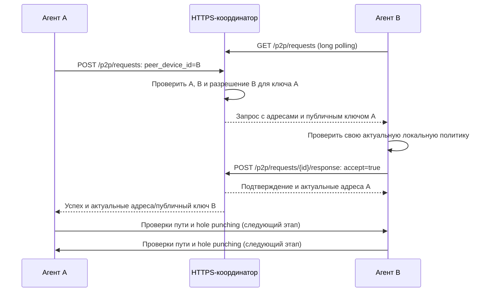

# HTTPS-координатор Portal

`portal-coordinator` — отдельный процесс, который хранит состав одной сети,
назначает виртуальные адреса, распространяет опубликованные агентами разрешения
и передаёт запросы на подготовку P2P-подключений.
Используются только HTTPS-запросы, включая long polling. WebSocket не используется.

На первом старте автоматически создаются сеть и пользователь `admin`. Его токен
записывается в `STATE_DIR/admin.token` с правами `0600`. На следующем старте
сохраняются тот же пользователь, токен, идентификатор сети, поколение и ревизия.
Пользователь `admin` не получает сетевой доступ к чужим устройствам и не может
изменять их политики или отзывать их токены. Он управляет устройством координатора;
регулирование регистрации со стороны admin будет добавлено отдельно.

Регистрация пользователей сейчас открытая. Имена уникальны без учёта регистра
ASCII; `admin` зарезервирован автоматически созданной учётной записью.
В первой версии вход выполняется по случайному bearer-токену, который выдаётся
при регистрации. Сохраните его: пароли, повторный вход и восстановление аккаунта
пока не реализованы. В БД хранятся SHA-256 хеши токенов, сами токены не журналируются.

`portal-runtime` подключается к этому API, применяет карту сети и TCP-разрешения
в workers. См. [запуск управляемого агента](RUNTIME.md).

## Запуск

Сервер работает без root, TUN и настроек маршрутизации. Нужны TLS-сертификат и
соответствующий приватный ключ в PEM. Для локальной разработки можно создать
самоподписанный сертификат:

```sh
umask 077
mkdir -p coordinator-tls
openssl req -x509 -newkey rsa:2048 -nodes -days 365 \
  -keyout coordinator-tls/key.pem \
  -out coordinator-tls/cert.pem \
  -subj '/CN=localhost' \
  -addext 'subjectAltName=DNS:localhost,IP:127.0.0.1' \
  -addext 'basicConstraints=critical,CA:FALSE'
cargo run -p portal-coordinator -- --config coordinator/example.json
```

[Пример конфигурации](../coordinator/example.json) слушает `127.0.0.1:8443`.
Для удалённых клиентов задайте доступный адрес прослушивания и сертификат для
имени сервера. TLS обязателен также на loopback; переключателя на HTTP нет.
Клиент должен проверять цепочку доверия и имя сервера. Для самоподписанного
сертификата доверие задаётся явно, например `curl --cacert`; не отключайте проверку.
Пути в JSON разрешаются относительно файла конфигурации.

```sh
curl --cacert coordinator-tls/cert.pem https://localhost:8443/health
curl --cacert coordinator-tls/cert.pem https://localhost:8443/api/v1/users \
  -H 'Content-Type: application/json' \
  -d '{"name":"alice"}'
```

Ответ регистрации — `{"user": {...}, "access_token": "usr_..."}`.
Для последующих запросов передавайте токен в `Authorization: Bearer usr_...`.
Приватные WireGuard-ключи остаются на устройствах; координатор принимает только
публичный ключ (64 символа hex).

```http
POST /api/v1/devices
Authorization: Bearer usr_...
Content-Type: application/json

{
  "name": "laptop",
  "public_key": "PUBLIC_WIREGUARD_KEY_AS_64_HEX_CHARACTERS",
  "endpoints": ["198.51.100.10:51820"]
}
```

Этот запрос является подтверждением владельца: пользователь добавляет устройство
к своему аккаунту. Произвольный `owner_user_id` в теле запроса отклоняется.
Ответ — `{"device": {...}, "access_token": "dev_..."}`. У устройства собственный
токен; токен пользователя не нужен ему для фоновых обращений к координатору.
Передачу подтверждения через одноразовый код можно добавить при реализации
интерактивного подключения устройств.

## HTTP API v1

Во всех запросах с телом используется JSON. Ответы с токенами и карты сети
содержат `Cache-Control: no-store`. Токены не передаются через URL.

| Метод и путь | Авторизация | Назначение |
|---|---|---|
| `GET /health` | Не требуется | Проверить доступность процесса и хранилища |
| `POST /api/v1/users` | Не требуется | Зарегистрировать пользователя: `{"name":"alice"}` |
| `GET /api/v1/users?name=alice` | Пользователь | Найти учётную запись по имени |
| `GET /api/v1/me` | Пользователь | Получить свою учётную запись |
| `POST /api/v1/devices` | Пользователь | Зарегистрировать своё устройство |
| `GET /api/v1/devices` | Пользователь | Получить свои активные устройства |
| `DELETE /api/v1/devices/{id}` | Владелец | Отозвать устройство; ответ `204` |
| `POST /api/v1/devices/{id}/token` | Владелец | Заменить токен устройства, сохранив его ID, WG-ключ и IP |
| `GET /api/v1/device` | Устройство | Получить собственные данные |
| `PUT /api/v1/device/endpoints` | Устройство | Заменить свои адреса-кандидаты: `{"endpoints":[...]}` |
| `PUT /api/v1/device/policy` | Устройство | Опубликовать применённую локальную политику |
| `GET /api/v1/network-map` | Устройство | Получить полный снимок карты или ждать изменения |
| `POST /api/v1/p2p/requests` | Устройство A | Запросить подготовку подключения к B и дождаться его ответа |
| `GET /api/v1/p2p/requests` | Устройство B | Получить ожидающие запросы на подключение через long polling |
| `POST /api/v1/p2p/requests/{id}/response` | Устройство B | Принять или отклонить конкретный запрос |

При отсутствии/отзыве токена возвращается `401`; чужое устройство недоступно
для управления (`404`); конфликт имени, ключа, лимита или ревизии — `409`;
неверные значения — `400`; неверная структура JSON — `422`; слишком большое
тело — `413`; перегрузка — `503`. Прикладные ошибки возвращают `{"error":"..."}`;
ошибки извлечения тела/параметров Axum могут возвращаться текстом.

## Политики

На каждом устройстве назначения хранится собственный словарь разрешений:
`публичный WG-ключ устройства-источника → { tcp: [порты назначения] }`.
Разрешения выдаются конкретной паре устройств. Совпадение владельца не даёт
сетевых прав; новое устройство пользователя и новый WG-ключ не наследуют
разрешения других устройств.

Источником политики остаётся локальный файл устройства назначения. Агент сначала
применяет изменение, затем публикует подтверждённый снимок от имени устройства.
Координатор проверяет токен устройства и хранит его отчёт; проверить фактическую
фильтрацию на удалённом хосте сервер не может. Токен пользователя, чужого устройства
и роль admin не позволяют опубликовать политику вместо устройства назначения.

Пример тела `PUT /api/v1/device/policy`:

```json
{
  "base_revision": 0,
  "permissions": {
    "PUBLIC_KEY_НОУТБУКА_КОЛЛЕГИ_64_HEX": {
      "tcp": [80, 443]
    },
    "PUBLIC_KEY_ТЕЛЕФОНА_КОЛЛЕГИ_64_HEX": {
      "tcp": [443]
    }
  }
}
```

На сервере этот снимок разрешает ноутбуку TCP/80 и TCP/443, а телефону — только
TCP/443 именно этого сервера. Политика другого устройства назначения не меняется.
Обратное инициирование соединений также не разрешается. Если ключ отсутствует
или список TCP-портов пустой, доступа нет. Пользовательские правила пока только
для TCP; UDP и ICMP не представлены в этом словаре. Это не ограничивает внешний
UDP-транспорт самого WireGuard.

Ключи должны принадлежать зарегистрированным активным пирам; ключ самого устройства
назначения не принимается. Координатор нормализует hex в нижний регистр, сортирует
и удаляет дубли портов; конфликтующие написания одного ключа отклоняются.
Порты задаются числами от 1 до 65535. Записи с пустым `tcp` удаляются из снимка.

`base_revision` — последняя подтверждённая координатором версия политики этого
устройства, первоначально `0`. Изменение увеличивает её и общую ревизию сети.
Публикация эквивалентного словаря с актуальной базовой версией не меняет ревизии.
Устаревшая база отклоняется с `409`; после неопределённого результата запроса
агент сверяет карту перед повтором. Снимок заменяет всю политику; пустой
`permissions: {}` отзывает все её разрешения.

Будущий веб-клиент сможет по явному выбору пользователя скопировать разрешение
на выбранные устройства. Это разовая операция над конкретными ключами и локальными
политиками устройств назначения, с возможностью менять порты отдельно. Она
не создаёт правило на пользователя и не распространяется на будущие устройства.
При массовом изменении целевые агенты должны подтвердить применение каждый своей
политики; недоступные устройства показываются как ожидающие применения.
Веб-клиента и массового API применения в текущем проекте пока нет.

Политики выхода в интернет будут определены при реализации exit nodes вместе
с транзитной фильтрацией и маршрутизацией.

## Карта сети и long polling

Первый `GET /api/v1/network-map` возвращает полный снимок:

- `protocol_version: 2`, стабильный `network_id`, `generation`, `revision`;
- `generated_at` и `expires_at` — Unix-время в секундах;
- собственные `user`, `device` и подтверждённую `policy`;
- `peers` — только нужных пиров, их подтверждённую принадлежность пользователям,
  WG-ключи, IPv4/IPv6, адреса-кандидаты и версию их политики;
- для каждого пира — `incoming` и `outgoing`, каждый в виде `{ "tcp": [...] }`.

`incoming` описывает инициирование пиром подключений к этому устройству,
`outgoing` — инициирование этим устройством подключений к пиру. Порты относятся
к соответствующему назначению. Даже при одностороннем разрешении оба участника
получают публичные ключи друг друга. Таблица состояний ответного трафика будет
реализована в агенте. IP в реестре — отдельные адреса узлов (/32 и /128),
а не объявление разрешённых транзитных подсетей.

Последующий запрос:

```http
GET /api/v1/network-map?generation=GENERATION&after=REVISION&wait_seconds=25
Authorization: Bearer dev_...
```

Если ревизия отличается или поколение не совпало, полный снимок отдаётся сразу.
Если оба значения совпадают, сервер ждёт изменения до 25 секунд (не дольше
половины срока действия карты), после чего всё равно отдаёт полный снимок.
Это обновляет срок действия при неизменной политике. `wait_seconds=0` отключает
ожидание. Агент открывает следующий HTTPS-запрос после получения ответа.

Пропущенные обновления и переподключение не требуют воспроизводить цепочку дельт.
Отзыв и ротация токена перепроверяются перед ответом уже ожидающему клиенту.
Разрешён один ожидающий запрос на токен, максимум 256 одновременно. При `503`
клиент повторяет запрос с backoff. Разрыв соединения освобождает место ожидания.

Срок действия по умолчанию — 300 секунд (настраивается от 30 до 3600). Runtime
применяет монотонный deadline и блокирует трафик по истечении срока карты.

## Подготовка P2P-подключения

Координатор выполняет только согласование начала соединения. Агенты сами
проверяют пути, выполняют hole punching и устанавливают WireGuard-сессию.
Текущая реализация передаёт адреса-кандидаты, а не гарантированно работающий путь.
Runtime использует эти API для команды `portal connect` и автоматически
обрабатывает входящие запросы. Hole punching и fallback через реле пока не реализованы.



**Запрос A.** Устройство отправляет `POST /api/v1/p2p/requests` со своим токеном:

```json
{"peer_device_id": "d_ID_УСТРОЙСТВА_B"}
```

Источник определяется по токену. Передать произвольный source, ключ или адрес
в этом запросе нельзя. Оба устройства должны быть активны и заранее опубликовать
непустые `endpoints`. В локальной политике B, подтверждённой координатору, для
ключа A должен быть хотя бы один разрешённый TCP-порт. Совпадение владельца
не заменяет разрешение. Запрос готовит сетевой путь между устройствами, поэтому
конкретный TCP-порт здесь не указывается; доступ к портам затем проверяет ACL B.
Разрешение A → B не даёт B права инициировать обратные прикладные подключения.

POST A ожидает подтверждения B до 10 секунд. Само добавление запроса в очередь
или получение уведомления B не считаются успехом для A.

**Получение на B.** Агент держит `GET /api/v1/p2p/requests?wait_seconds=25` со
своим токеном. Ответ имеет вид `{"requests":[...]}`; при отсутствии запросов
после таймаута — `{"requests":[]}`. `wait_seconds=0` возвращает результат сразу.
Максимальное ожидание — 25 секунд. Неподтверждённые запросы возвращаются повторно
с тем же ID до ответа, отмены или истечения срока; агент обрабатывает ID повторно
без повторного запуска уже начатой попытки.

Каждый элемент содержит `request_id`, `protocol_version`, `network_id`,
`generation`, `revision`, `peer` (данные A с виртуальными IP, публичным ключом
и кандидатами), `permissions` (существующие права A → B), `target_policy_revision`
и `expires_at` (Unix-время). Эти данные помогают сопоставить сигнал с картой,
но не заменяют собственную политику устройства и проверку личности прямого пира.

**Ответ B.** Агент автоматизированно проверяет локальную готовность и актуальную
политику, затем вызывает `POST /api/v1/p2p/requests/{id}/response` со своим токеном:

```json
{"accept": true}
```

Координатор повторно проверяет обе идентичности и разрешение. B получает `200`
с актуальной информацией об A; ожидающий POST A получает `200` с такой же
структурой, но `peer` содержит B. После этого оба агента могут начать проверку
пути без участия координатора. `200` подтверждает готовность к попытке P2P,
а не успешный hole punching или установление WireGuard-сессии.

`{"accept":false}` возвращает B `204`, а A — `403` с причиной отказа. Ответить
на запрос может только устройство B: его владелец с пользовательским токеном
или другое устройство, в том числе того же владельца, его не подменяют.
Ответ на завершённый/отменённый/истёкший ID возвращает `404`.

Ошибки запроса A: `401` — недействительный токен устройства; `403` — нет
разрешения A → B или B отказал; `404` — B неизвестен/отозван; `400` — запрос
к самому себе или некорректный ID; `409` — нет кандидатов или такая пара уже
ожидает ответа; `503` — превышен лимит ожидающих запросов; `504` — B не ответил
в течение 10 секунд. При отзыве токена A или разрешения во время ожидания запрос
тоже завершается ошибкой. Закрытие запроса A отменяет его сигнал при отмене
обработчика; срок в 10 секунд в любом случае ограничивает время ожидания.

Сигналы хранятся только в памяти, не меняют ревизию карты сети, не создают новых
разрешений и не сохраняют состояние туннеля. После перезапуска сервера клиенты
повторяют незавершённые попытки. Лимиты: 64 ожидающих запроса всего, до 4 от
устройства A, до 8 на устройство B и один запрос на направленную пару A → B.
Для получения уведомлений допускается один long-poll запрос на токен и до 128
одновременно. После `503` или сетевой ошибки клиент делает повтор с backoff;
повтор POST A создаёт новую попытку, автоматической гарантии exactly-once нет.

## Хранение и пределы

SQLite выполняет операции в отдельном потоке за очередью на 128 заданий.
Одновременно обрабатывается до 512 HTTP-запросов. Тело запроса ограничено 64 KiB;
в сети до 1024 пользователей (включая admin) и 4096 зарегистрированных устройств,
до 64 активных устройств на пользователя, до 8 адресов-кандидатов на устройство.
Политика содержит до 256 ключей пиров, для каждого — до 1024 TCP-портов.

Выдача адресов и изменения политики/реестра транзакционные. Отозванные записи
сохраняются; их IP не выдаются повторно, WG-ключи не регистрируются заново. Это ограничивает общий ресурс
регистраций и исключает передачу адреса новому устройству при старых картах.

Каталог состояния на Unix должен иметь права `0700`, файлы с секретами и БД —
`0600`. Каталог блокируется от одновременного запуска двух координаторов.
Резервную копию делайте при остановленном сервере, сохраняя весь каталог, включая
`admin.token` и файлы SQLite WAL. При утрате admin.token сервер не создаёт замену
с доступом к существующей сети. Изменение диапазонов IP требует отдельной
миграции. Текущая версия схемы БД — 4.

При обновлении версии 2 старые пользовательские политики архивируются,
новые словари разрешений пусты, версии политик и сети увеличиваются, поколение
меняется. Автоматического разворачивания старых прав на ключи устройств нет:
владельцы явно публикуют новые локальные политики. Учётные записи, токены,
WG-ключи и IP сохраняются. При обновлении версии 3 текущие разрешения, ревизии
и поколение сохраняются. Неиспользуемый `users.revoked` удаляется; если в старой
БД уже есть ненулевые значения, сервер требует явной миграции вместо молчаливого
восстановления доступа отключённым пользователям.

Колонка `legacy_user_policy`, если она есть, экспортируется в файл
`STATE_DIR/legacy-user-policies.json` с правами `0600` и удаляется из БД.
Файл содержит объект `DeviceId → исходный JSON политики в виде строки`.
Архив записывается атомарно и синхронизируется на диск до фиксации миграции;
ошибка записи сохраняет старую схему и данные. При повторе после сбоя принимается
только идентичный архив, существующий файл с другим содержимым не перезаписывается.
После проверки архива и резервной копии пользователь может удалить этот файл;
сервер его не применяет и автоматически не удаляет.

Самый ранний экспериментальный формат версии 1 не мигрируется. Версия протокола
карт и политик остаётся 2; клиенты должны проверять её перед применением.
Возврат к исторической резервной копии работающей сети требует отдельной процедуры
смены поколения; автоматическое восстановление после отката БД пока не реализовано.

## Организация кода

`api.rs` содержит маршруты, auth-extractor и небольшой фасад вызовов БД.
Разбор `Authorization` общий для всех защищённых маршрутов; проверка действительности
и роли токена выполняется операциями Store. `poll.rs` объединяет ограничения по
хешу токена, освобождение слотов и ожидание уведомлений с повторным чтением
аутентифицированного состояния. Длительность карты хранится в ApiState и передаётся
в Store при построении снимка. `Permissions` использует BTreeMap для стабильного
порядка ключей при сериализации JSON. Общие wire-модели находятся в
`net/src/model.rs`; модуль `coordinator::models` их реэкспортирует. Координатор
использует `portal-net` без feature `agent`, поэтому HTTPS-клиент и WireGuard
ему не требуются.

Хранилище разделено на модули в `coordinator/src/store/`:

| Модуль | Ответственность |
|---|---|
| `mod.rs` | Store, открытие состояния, общие счётчики |
| `schema.rs` | DDL, миграции, архив старых политик |
| `validate.rs` | Проверка имён, ключей, адресов и TCP-портов |
| `users.rs` | Регистрация, аутентификация и поиск пользователей |
| `devices.rs` | Устройства, адреса, отзыв и токены |
| `policy.rs` | Публикация и чтение локальных разрешений |
| `network_map.rs` | Построение карт сети |
| `connections.rs` | Проверка и подготовка P2P-контекста |

Публичный Coordinator предоставляет запуск HTTPS, не экспортируя Router.
Метод `test_router()` компилируется только с `cfg(test)`; сценарии API находятся
в `src/tests.rs` и по-прежнему проверяют настоящий HTTPS-сервер.

## Проверка

```sh
cargo test -p portal-coordinator
```

Проверяются настоящий HTTPS с доверенным тестовым сертификатом, отклонение
недоверенного сертификата и незашифрованного HTTP, открытая регистрация,
автоматический admin, отсутствие неявных прав, разделение источников и назначений,
индивидуальные TCP-порты, миграция старой БД, long polling, подготовка P2P через
HTTPS с ответом B, отказом, таймаутом, отменой и актуализацией кандидатов,
продление карты, ротация/отзыв токенов, откат невалидных операций и перезапуск.
Отдельно проверяются валидаторы, стабильный JSON, общий auth-extractor и
миграции с сохранением архива и защитой от восстановления отключённых аккаунтов.
Тест HTTPS открывает временный loopback-порт; TUN и root не нужны.
