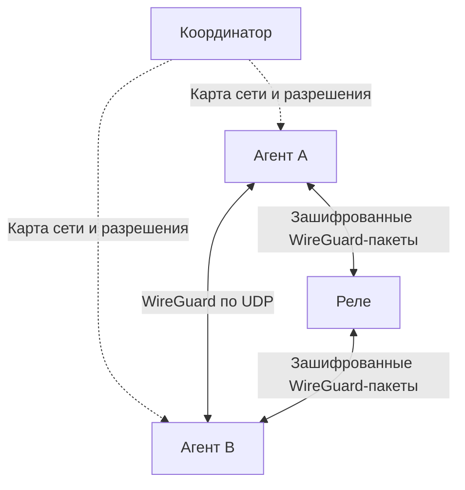

# План сетевой основы Portal

## Что есть сейчас

База — WireGuard через BoringTun, TUN и сетевой стек ОС. Прикладные сервисы
удалены. Отдельный HTTPS-координатор реализован: реестр пользователей/устройств,
автоматический admin, открытая регистрация, хранение опубликованных политик и
карты сети через HTTPS long polling. Реализовано также согласование P2P-запроса
A → B с уведомлением B по HTTPS и ответом A после подтверждения B. [Протокол и запуск](COORDINATOR.md).
Подключение runtime к координатору, сетевые ACL, обнаружение адресов и реле
ещё не реализованы. Выдача политики сервером пока не ограничивает реальные пакеты.
Регистрация пира и его `AllowedIPs` сейчас дают связность, но не ограничивают
доступ к отдельным TCP/UDP-портам.

| Часть | Текущее расположение |
|---|---|
| WireGuard, пиры, маршрутизация по AllowedIPs | `wireguard/src/device/` |
| Обработка пакетов и таймеров | `wireguard/src/runtime/worker.rs` |
| TUN, UDP, epoll | `wireguard/src/platform/linux/mod.rs` |
| Жизненный цикл агента и маршруты ОС | `runtime/src/runtime.rs` |
| Операции Linux, ключи, API-токен | `runtime/src/platform/` |
| Локальный HTTP API управления | `runtime/src/api.rs` |
| Диагностический клиент API | `cli/` |
| HTTPS-координатор, SQLite, политики и long polling | `coordinator/` |

Существующий `wireguard/scripts/check-kernel-interop.sh` проверяет совместимость
с Linux WireGuard. Это отдельная привилегированная проверка, а не тест всей
будущей сетевой системы.

## Целевая архитектура

Управление образует звезду: все агенты обращаются к координатору по HTTPS,
изменения получают через long polling. Данные идут между пирами напрямую или через общее реле.
Координатор и реле могут жить на одном сервере, но остаются отдельными ролями.

- Пользователь и устройство — разные сущности. У пользователя стабильный
  `UserId`, у устройства — `DeviceId`, один владелец `owner_user_id`, собственные
  приватные ключи и назначенные координатором виртуальные адреса.
- Помимо связи по адресам Portal базовая функциональность включает выход в
  интернет через выбранное устройство (exit node). Этот этап следует после
  сетевой связности и ACL. Произвольные LAN-подсети пока не объявляются.
- Создание сети начинается на координаторе; автоматически создаётся пользователь
  `admin`. Он владеет устройством координатора, без особых прав доступа к чужим
  устройствам или изменения их политик. Сейчас регистрация пользователей открытая;
  регулирование регистрации со стороны admin добавляется позже.
- На устройстве один UDP-сокет на семейство адресов обслуживает WireGuard,
  STUN и проверку прямых путей. Сокет не пересоздаётся при успешном hole punching.
- Разрешения применяются на конечных устройствах до передачи пакетов в ОС.
  Каждая пара устройств требует явного разрешения по WG-ключу источника
  и TCP-портам назначения, в том числе между устройствами одного владельца.
- Реле пересылает внутреннее сквозное WireGuard-соединение и не расшифровывает его.
- Сервисы в будущем используют обычные сокеты на виртуальном IP. Их протоколы,
  порты и жизненный цикл не входят в сетевой транспорт.
- Первый вариант ориентирован на Linux. Платформенные операции изолируются;
  Windows и мобильные VPN API подключаются отдельными реализациями позже.

## 1. Модель состояния сети и границы модулей

Добавить `portal-net` в `net/` как модуль сетевого агента без пользовательского
TCP/IP-стека. Код создавать по мере появления поведения, без пустых заглушек.

| Модуль | Ответственность |
|---|---|
| `net/model` | Идентичность, описание пира, адреса, версия карты сети |
| `net/policy` | Правила доступа, компиляция, проверка потоков |
| `net/transport` | Прямые и ретранслируемые зашифрованные пакеты |
| `net/discovery` | STUN, кандидаты адресов, проверки доступности |
| `net/agent` | Применение карты сети и управление состоянием подключений |
| `coordinator/` | Реестр устройств, адреса, политики, протокол управления |
| `runtime/` | Запуск агента, локальная конфигурация, API и платформа |

Определить `UserId`, `User`, `DeviceId`, `Device` с `owner_user_id`, привязку
WireGuard-ключа к устройству, `Peer`, `NetworkMap`, `Policy` и `RelayDescriptor`.
Один пользователь владеет несколькими устройствами; у устройства в первой
версии один владелец. Пользователь Portal не является учётной записью ОС,
а роль координатора не означает владение всеми участниками сети.

Версия карты должна включать поколение состояния координатора и монотонную
ревизию внутри него. Ротация WG-ключа не меняет `DeviceId`, переименование или
смена способа входа пользователя не меняет `UserId`. Совместное владение,
группы и временный доступ отдельных устройств можно добавить позже.

Зафиксировать пределы: число пиров, правил, адресов-кандидатов, соединений,
размер управляющего сообщения и очередей. Валидировать всю конфигурацию до
изменения работающего состояния. В первой версии выдавать узлам IPv4 /32 и
IPv6 /128; произвольные транзитные AllowedIPs не принимать. Маршруты выхода в
интернет допускаются только отдельным явно разрешённым режимом exit node.

**Готовность:** модель сериализуется; неизвестный владелец, неподтверждённая
привязка устройства к пользователю, некорректные ключи, дубли адресов,
конфликты владения IP и превышение лимитов отклоняются до применения.

## 2. Разрешения на реальном пути пакета

Источником политики доступа к устройству является его локальный файл разрешений,
которым управляет владелец. Координатор хранит подтверждённую копию, вычисляет
эффективный доступ и распространяет изменения. Он проверяет, что издатель
изменения вправе менять политику именно этого устройства. Центральный интерфейс
отправляет изменение на устройство назначения и ждёт подтверждения применения.
Версии локальных политик входят в карту сети; офлайн-изменение не считается
применённым на устройстве до его подтверждения. Локальный отзыв действует сразу.

На каждом устройстве политика — простая hashmap:
`публичный WG-ключ пира-источника → { tcp: [локальные порты назначения] }`.
Право на TCP/443 сервера для ноутбука коллеги не даёт его телефону права на сервер
и не открывает доступ ни одному из них к другим устройствам назначения.
Совпадение пользователя-владельца тоже не создаёт сетевого разрешения.

Политики направленные и содержат только разрешающие записи. Отсутствие ключа
или пустой список портов означает запрет; порты — отдельные числа 1–65535.
Правила по пользователям, неявные права владельца и наследование разрешений
новыми устройствами не используются. Ротация WG-ключа требует явного изменения
записей: стабильный DeviceId не переносит старое разрешение на новый ключ.
Пользовательский формат пока только TCP; отдельные UDP/ICMP-разрешения можно
добавить позже без разрешения неподдерживаемых протоколов по умолчанию.

В будущем веб-клиент сможет по явному выбору пользователя распространить правило
на выбранные существующие устройства. Это разовое копирование конкретных ключей
и портов в соответствующие локальные политики, а не постоянное правило на все
устройства пользователя. Каждое назначение подтверждает применение отдельно;
недоступное устройство не считается обновлённым. Новые устройства не получают
доступ от ранее выполненного массового копирования. Порты остаются независимо
редактируемыми для каждой пары устройств.

Агент сопоставляет записи hashmap с подтверждёнными активными пирами из карты.
Цепочка доверия: аутентифицированный WG-ключ → активное устройство → явная запись
в локальной hashmap назначения. UserId используется для владения и управления,
но не для сетевых разрешений. `AllowedIPs` продолжает проверять владение IP ключом;
ACL дополнительно проверяет TCP-порт назначения. Внешний UDP IP и заявленный
отправителем UserId не задают личность. Отключённые сервисы не запускаются
автоматически; сетевое разрешение само по себе не даёт вход или root-права в ОС.

Точки интеграции в `wireguard/src/runtime/worker.rs`:

- `write_inner_packet`: после проверки ключа и исходного IP, до `write_tun`.
- `handle_tun`: после выбора конечного пира, до шифрования и постановки
  внутреннего пакета в очередь BoringTun; проверять также допустимый исходный IP.

Механизм policy передавать в WireGuard через узкий интерфейс со статической
диспетчеризацией: криптографический код не должен зависеть от координатора.
Поддержать ограниченную таблицу состояний TCP: ответ разрешённому потоку
может пройти без отдельного обратного правила. Для TCP учитывать установление
и закрытие соединения, а не разрешать произвольный пакет с флагом ACK.
Ограничить время жизни и количество записей; правила фильтрации являются ACL,
а не полной реализацией TCP.

Смена политики инвалидирует записи потоков, которые больше не разрешены.
Определить момент завершения отзыва и синхронизацию с workers, уже получившими
ссылку на пира: удаление записи из реестра само по себе не прекращает такую обработку.
Перед отправкой в ОС повторно проверять актуальную политику для внутренних
пакетов, задержанных в очереди WireGuard. Исходящие пакеты, ожидающие handshake,
также не должны уходить после отзыва доступа: очередь нужно либо держать выше
криптографического слоя с повторной проверкой, либо очищать при отзыве.
Обновление не отзывает байты, уже доставленные в сокеты ОС до его применения.

Разбор IPv4/IPv6 должен проверять длины, extension headers и границы заголовков.
Для первого варианта фрагменты IP запрещать до появления безопасного учёта
фрагментов; запрещённый/неподдерживаемый пакет не должен обходить проверку портов.
Связанные ICMP-ошибки, включая Packet Too Big, пропускать только после проверки
вложенного заголовка и связи с разрешённым потоком, чтобы работал PMTU discovery.

**Готовность:** два устройства с ручной конфигурацией обмениваются только
разрешёнными TCP-потоками. Проверены ответы, IPv4/IPv6, подмена source IP,
истечение состояний, отзыв разрешения и конкурентная смена политики. Отдельно
проверены отсутствие неявного доступа между устройствами одного владельца,
разные порты для разных ключей, независимость устройств назначения, отсутствие
наследования новыми устройствами и отзыв пира. Неподдерживаемые протоколы
не обходят TCP-фильтр; связанные ICMP-ошибки проходят только для разрешённых потоков.
Для проверок используются временные сокеты и network namespace, без системы сервисов.

## 3. Применение состояния агентом

Добавить `apply_network_map`: вычисление разницы пользователей, принадлежности
устройств, пиров, ключей, адресов, маршрутов и политик. Неизменившиеся пиры
сохраняют WireGuard-сессии. При отзыве устройства удаляются его ключи, права
и состояния потоков; при блокировке пользователя — права всех его устройств.
Смену владельца проводить отдельной подтверждённой операцией с пересчётом
доступа и ротацией удостоверений устройства, без наследования прав прежнего владельца.
Сначала применяются ограничения, затем открывается доступ новым конфигурациям:
промежуточное состояние может временно запретить трафик, но не расширить права.

Публиковать согласованные снимки пиров и политик для workers. Поскольку операции
ОС не являются общей атомарной транзакцией с WireGuard, предусмотреть порядок
действий, откат, повторную сверку и явное состояние ошибки. При неустранимой
ошибке останавливать агент с очисткой принадлежащих ему ресурсов.

Сохранить ручной режим для разработки. В управляемом режиме локальный API
не может самовольно назначать владельца или регистрировать доверенные устройства.
Владелец вправе изменять локальные разрешения своего устройства; агент применяет
их и публикует координатору. Полученный от координатора список доступных ресурсов
служит для интерфейса и подготовки соединения; окончательное решение принимает
целевое устройство по своей политике и проверенной принадлежности пира.

Runtime использует один Tokio runtime для управляющих задач и отдельные
существующие WireGuard workers для пакетов. Платформу выбирать при компиляции;
не переносить старый `Arc<dyn HostPlatform>` в новую модель без необходимости.
Конфигурацию запуска вынести из набора CLI-флагов в файл, оставив CLI
диагностическим клиентом локального API.

**Готовность:** применение снимка повторяемо; ошибки маршрутов и прерывание
обновления не оставляют лишних разрешений или чужих удалённых маршрутов.

## 4. Координатор и регистрация устройств

Реализовать один сервер и постоянное хранилище пользователей, принадлежности
устройств, назначенных адресов, подтверждённых политик и их ревизий.
Сложная кластеризация на этом этапе не нужна. Разделить вход пользователя
и долговременную аутентификацию устройства.

Регистрация пользователей пока открытая по HTTPS-адресу координатора; при создании
сети автоматически создаётся учётная запись `admin`. Регистрацию устройства
подтверждает владелец запросом с собственным токеном пользователя. Одноразовый
код для интерактивного добавления можно реализовать позже. Поле `owner_user_id`
из произвольного запроса не является доказательством владения. Доверенный адрес
и TLS-идентичность координатора задаются при подключении; управляющее соединение
работает до готовности туннеля.

Для постоянной аутентификации устройства используется отдельный случайный
bearer-токен поверх проверяемого TLS; в БД хранится его хеш. Не использовать
WireGuard X25519 как ключ цифровой подписи. Привязка токена к WG-ключу хранится
координатором вместе с `DeviceId`, `UserId` и состоянием допуска;
приватные ключи не рассылаются. Обычный рестарт устройства не требует повторного
входа человека. При отзыве устройства его удостоверение больше не принимается.

Через HTTPS отдавать полные снимки, обновления получать через long polling.
WebSocket не используется. При таймауте отдавать свежий снимок с продлённым сроком
действия даже без изменения ревизии. При пропуске ревизий достаточно нового снимка.
Клиент получает только нужных ему пиров и локально применимые правила.
Ключи должны быть известны обеим сторонам разрешённого потока, даже если
инициировать его может только одна сторона.

Сохранять последнюю проверенную карту атомарно, с правами доступа владельца.
Определить срок действия разрешений: при отключении координатора карта работает
до его истечения, затем защищаемый трафик блокируется. Немедленный глобальный
отзыв при недоступном координаторе не обещается. Учесть неверное время ОС,
повтор старых сообщений и восстановление поколения после рестарта сервера.

**Готовность:** два агента регистрируются, получают уникальные IP и разрешения,
переподключаются после обрыва; отзыв устройства закрывает доступ онлайн,
а офлайн-доступ ограничен сроком действия карты. Регистрация чужого устройства
на пользователя без его подтверждения отклоняется; добавление устройства не
выдаёт ему разрешений других устройств, а отзыв исключает его из разрешённых связей.

## 5. Общий UDP-транспорт и обнаружение адресов

Разделить текущий `PacketIo` на платформенное взаимодействие с TUN/UDP и
выбор внешнего пути пакета. Сохранить существующую WireGuard-криптографию,
таймеры, rate limit и worker-потоки. Предусмотреть приём зашифрованного пакета
как с прямого UDP-пути, так и от реле, без подмены всех пиров одним адресом реле.

Служебные пакеты классифицировать до `Tunn::parse_packet`. Обычный WireGuard-пир
должен продолжать работать без понимания нашего discovery-протокола.
STUN и пробные пакеты отправляются с того же сокета, что WireGuard.
Использовать несколько STUN-наблюдений, локальные адреса и доступный port mapping;
внешний порт не считать равным локальному и не считать STUN-адрес универсальным
для всех назначений.

Проверки пути аутентифицировать, ограничивать по размеру, частоте, времени и
количеству кандидатов. Координатор передаёт проверяемые адреса и сигналы обеим
сторонам, но не объявляет путь работающим вместо них. Внешний источник пакета
реле не должен становиться прямым endpoint конечного WireGuard-пира.

**Готовность:** WireGuard и discovery делят сокет, неизвестные пакеты безопасно
отбрасываются; внешний адрес обнаруживается без закрытия транспортного сокета.

## 6. Установка и сопровождение P2P-пути

Серверная часть согласования реализована: A вызывает HTTPS POST намерения
подключиться к B; B получает запрос через HTTPS long polling и отвечает агентом.
Координатор проверяет активность обоих устройств, разрешение по ключу A в политике B
и наличие кандидатов адресов. A получает успех с данными B только после его
подтверждения; при отказе или отсутствии ответа возвращается ошибка. Ожидание
ограничено 10 секундами. Сигналы временные, не выдают разрешений и не означают,
что прямой путь уже работает. [Контракт запросов](COORDINATOR.md#подготовка-p2p-подключения).

Далее подключить этот протокол к агентам и добавить состояния `offline`, `probing`,
`direct`, `relayed` и переходы между ними. Они параллельно проверяют подходящие кандидаты и подтверждают
двустороннюю доступность. Закрепление адреса требует подтверждения личности
и достижимости; недоверенное сообщение не может перенаправить трафик.

Настроить ограниченный бюджет попыток, backoff и keepalive. Следить за сменой
сетевого интерфейса, снами устройства, изменением NAT и потерей доступности.
Адреса и разрешения реле сообщать заранее: fallback не требует нового запроса
координатору для каждой попытки. Не гарантировать прямой путь при произвольном NAT.

**Готовность:** проверены LAN, простой NAT, смена endpoint, неуспешный hole
punching и восстановление пути. Отдельно измеряются время подключения и потери.

## 7. Пересылка через реле

Первый вариант — достижимое UDP-реле, которое также может быть обычным участником
сети. Публичный IP и доступный UDP-порт задаются явно; доступность проверяется
извне. Координатор распространяет каталог реле и отдельные разрешения на их
использование. Реле не получает автоматически право доступа к виртуальным IP
клиентов и их будущим сервисам.

Перед реализацией зафиксировать wire-формат, готовую схему аутентификации
регистрации, подтверждение обратного адреса, сроки разрешений и защиту от replay.
Не вводить собственные криптографические примитивы. Отправитель и адресат
идентифицируются проверенными ключами; нельзя доверять полю source из пакета.

Пересылать исходные зашифрованные WireGuard-датаграммы через ненадёжный транспорт.
Не завершать внутренний WG-туннель на реле и не вводить QUIC поверх WireGuard.
Учесть дополнительный заголовок при выборе MTU. Ограничить клиентов, полосы,
очереди, время регистрации и частоту запросов; отозванные разрешения закрывают
пересылку, а не только запрещают следующую регистрацию.

При работающем реле продолжать редкие проверки прямого пути. Переключение
`relay ↔ direct` сохраняет виртуальные IP и WireGuard-сессию, поэтому TCP-сокеты
приложений не нужно пересоздавать. Потери при смене пути допустимы и измеряются.

**Готовность:** A → R → B работает без прямого пути, R не видит открытый IP-пакет;
проверены отзыв доступа, чужой ключ, перегрузка, остановка R и переход на direct.
Полная блокировка UDP в этот вариант не входит; TCP/TLS fallback рассматривается
отдельно позже, на выделенном сервере, с учётом TCP-over-TCP.

## 8. Выход в интернет через другое устройство

Реализовать exit node как базовую сетевую возможность. Объявление этой роли,
разрешение на её использование и выбор exit-устройства клиентом — отдельные
операции, не вытекающие автоматически из доступа к локальным портам устройства.

На клиенте настраиваются маршруты для интернет-трафика с сохранением внешнего
доступа для UDP-транспорта Portal, discovery, реле и управляющего HTTPS.
На exit-устройстве — forwarding, фильтрация транзита и исходящий NAT там, где
он требуется. Адреса обычных пиров остаются /32 и /128; ответы от внешних IP
проверяются в контексте выбранного exit-узла и разрешённых потоков.

Зафиксировать обработку DNS и обеих версий IP, исключения для LAN и поведение при
потере exit-узла. Предлагаемый исходный режим — блокировка интернет-трафика до
восстановления или явного отключения exit-режима. Остановка агента и ошибка
настройки не должны незаметно направлять защищаемый трафик в обход выбранного узла.
Конкретный контракт режима и восстановления уточняется перед его реализацией.

**Готовность:** интернет-трафик выходит через выбранное устройство, исключения
транспорта не образуют петлю; проверены IPv4/IPv6, DNS, отзыв разрешения, потеря
узла, смена direct/relay и восстановление принадлежащих Portal настроек ОС.

## 9. Стабилизация перед возвращением сервисов

В локальном API показать версию карты/политики, срок действия, состояние
координатора, пути к пирам, причины отказов и счётчики отбрасывания.
Логи не содержат приватных ключей и секретов регистрации.

Собрать воспроизводимые сценарии с временными namespace и контролируемыми
потерями/задержками. Проверить совместимость с Linux WG в ручном режиме,
ACL в IPv4/IPv6, нагрузку и лимиты памяти, рестарты, отзыв прав и отсутствие
непредусмотренного доступа во время обновлений. Не считать компиляцию заменой
проверке реального TUN/UDP-трафика.

Разделение привилегий оформлять после фиксации Linux-контракта: настройка
интерфейса/маршрутов — минимальный привилегированный компонент, остальной агент
и будущие сервисы — обычный пользователь. Платформенные детали остаются вне
модели политик и протокола координатора.

**Условие возврата сервисов:** координатор выдаёт идентичность и права, агенты
их применяют, прямой путь, реле и exit nodes работают, смена политики закрывает трафик,
ошибки и перезапуски не расширяют доступ. Только затем добавляются HTTP-файлы,
SSH и адаптеры других приложений с собственными прикладными разрешениями.

## Текущая последовательность реализации

Первым реализован HTTPS-координатор из этапа 4; работа сервера проверяется
отдельными клиентами без TUN. Его конечная готовность ещё требует подключения агентов.
Далее этапы 1–3: общая модель, ручной снимок, фильтрация в workers и применение
карты агентом. Доказать действие запрета на реальных пакетах устройств одного
владельца и разных пользователей, затем подключать агент к HTTPS API координатора.
Механизм загрузки плагинов определяется последним; динамические библиотеки
рассматриваются как возможный вариант, формат ABI пока не фиксируется.
